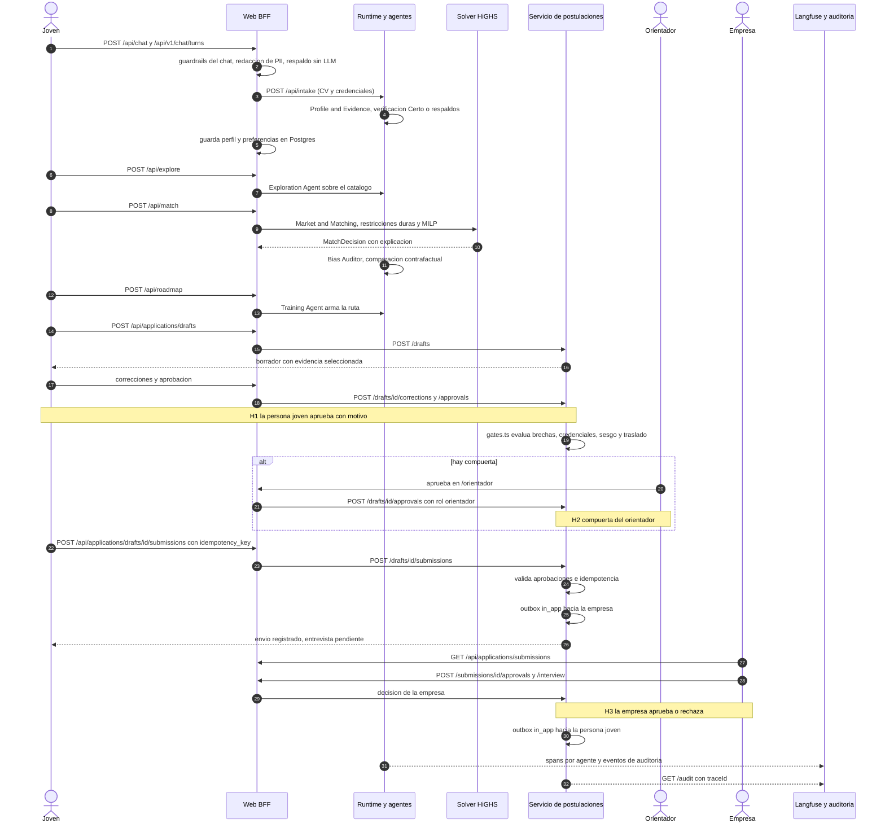

# WorkBridge: arquitectura

> Reto 3, empleabilidad juvenil en Panamá. Este documento es el diagrama de arquitectura exigido: agentes, herramientas, flujos y puntos de intervención humana. Documentos hermanos: [metodología](metodologia.md), [evals](evals.md), [bitácora de IA](bitacora-ia.md), [runbook de la demo](runbook-demo.md).

## 1. Resumen

WorkBridge conecta los tres lados del mercado de empleo juvenil con un orientador humano en el centro. La **persona joven** conversa con un asistente que arma su perfil y preferencias, recibe vacantes con una decisión explicable (apta, apta con brechas, no apta por ahora), una **ruta de formación** con cursos del catálogo de **centros de formación** y un borrador de postulación adaptado. La **empresa** publica vacantes (texto, PDF o imagen) que se normalizan, se auditan contra requisitos discriminatorios y se ordenan en una preselección; solo ella decide si avanza a entrevista. El **orientador** revisa los casos con brechas críticas, credenciales sin verificar, alertas de sesgo o traslado inviable. El LLM redacta y extrae, pero las decisiones que importan (aptitud, restricciones duras, asignación con el solver HiGHS, verificación de credenciales, compuertas humanas, notificaciones) se calculan en código determinista y quedan trazadas con `trace_id`.

## 2. Diagrama de arquitectura

```mermaid
flowchart LR
  subgraph SURF["Superficies (apps/web, Next.js)"]
    cand["Joven: chat, perfil, ruta, postulaciones"]
    emp["Empresa: vacantes y preseleccion"]
    cns["Orientador: cola de revision"]
  end

  subgraph BFF["BFF Next.js: apps/web/app/api"]
    api["api/chat, intake, explore, match, roadmap, interview, applications"]
  end

  subgraph EXEC["Plano de ejecucion: agentes (apps/agent-runtime/src/workflow/graph.ts, Mastra)"]
    a1["1 Exploration Agent<br/>valida preferencias y consulta catalogo<br/>tool: read_goals"]
    a2["2 Profile and Evidence Agent<br/>CV a perfil y evidencia<br/>tools: read_cv, list_declared_credentials"]
    a3["3 Market and Matching Agent<br/>vacante a requisitos y decision de aptitud<br/>tools: read_vacancy, match_skills"]
    a4["4 Bias Auditor<br/>auditoria contrafactual<br/>tool: audit_counterfactual"]
    a5["5 Training Agent<br/>brechas a ruta de formacion<br/>tool: suggest_course"]
    guard["Guardrails: screenInput, screenPermission, screenToolResult, screenOutput"]
    router["ModelRouter OpenRouter: cadena de modelos y presupuesto"]
  end

  subgraph DET["Componentes deterministas (codigo, no LLM)"]
    fair["Reglas de equidad de vacantes: vacancy/fairness.ts"]
    solver["packages/solver: restricciones duras, puntaje, MILP HiGHS, respaldo greedy"]
    gates["Compuertas del orientador: application/gates.ts"]
    rubric["Rubrica de entrevista simulada: interview/simulated-interview.ts"]
    gaps["packages/training: brechas, ranking y ruta"]
  end

  subgraph TOOLS["Herramientas que ACTUAN"]
    t1[("Escritura en Postgres Neon: perfil, preferencias, chat, idempotencia, outbox")]
    t2["Solver HiGHS Wasm: asigna candidatos a vacantes"]
    t3["Outbox de notificaciones in_app a joven, empresa y orientador"]
    t4["Verificacion de credenciales: Certo, luego Accredible, luego Credly, luego mock"]
    t5["Google Maps Distance Matrix y Geocoding, con matriz local de respaldo"]
  end

  subgraph APP["Servicio de postulaciones: application/service.ts (HTTP)"]
    draft["Borrador y evidencia seleccionada"]
    sub["Envio y estado de entrevista"]
  end

  subgraph HUM["Puntos de intervencion humana"]
    h1{{"H1 Joven aprueba o corrige el borrador"}}
    h2{{"H2 Orientador aprueba si hay compuerta"}}
    h3{{"H3 Empresa aprueba o rechaza la entrevista"}}
  end

  subgraph OBS["Trazabilidad"]
    lf[("Langfuse: trazas y spans por agente")]
    aud[("Registro de auditoria append-only y cola DQL")]
  end

  cand --> api
  emp --> api
  cns --> api
  api --> a1 --> a2 --> a3 --> a4 --> a5
  guard -. filtra .-> a1
  guard -. filtra .-> a3
  router -. LLM solo para redactar o extraer .-> a2
  a2 --> t4
  a3 --> fair
  a3 --> solver
  solver --> t2
  solver --> t5
  a4 -->|alertas y vacantes bloqueadas| gates
  a5 --> gaps
  api --> t1
  gates --> draft
  draft --> h1
  h1 -->|aprobado| h2
  gates -->|motivos| h2
  h2 -->|aprobado| sub
  sub --> t3
  t3 --> h3
  h3 -->|decision| t3
  a1 -. span .-> lf
  a2 -. span .-> lf
  a3 -. span .-> lf
  a4 -. span .-> lf
  a5 -. span .-> lf
  a3 -. evento .-> aud
  a4 -. evento .-> aud
  a5 -. evento .-> aud
  sub -. evento .-> aud
  rubric -. practica sin riesgo .-> cand
```

Lectura rápida del diagrama:

- **Cinco agentes con roles distintos** se encadenan como pasos de un workflow de Mastra (`AGENT_ORDER` en `apps/agent-runtime/src/workflow/graph.ts`), pasándose un portador (`carrier.ts`) y emitiendo un sobre (`AgentEnvelope`) por paso. **Ojo:** la flecha `api --> a1 --> ... --> a5` describe el diseño del grafo, no la ruta de la web. La web llama por separado al agente de perfil, al agente de exploración, al servicio de matching y a `buildRoadmap`; el auditor de sesgo y el grafo completo no están en esa ruta (sección 7).
- **Tres puntos humanos (H1, H2, H3)**. Los agentes no pueden enviar postulaciones, avanzar entrevistas ni enviar mensajes: `submit_application`, `progress_interview` y `send_message` están en la lista de herramientas siempre denegadas (`ALWAYS_DENIED` en `workflow/guardrails.ts`).
- El LLM (OpenRouter) solo interviene para conversar, extraer perfil o vacantes desde texto libre, imagen o PDF, y como respaldo narrativo en el router de modelos. Cada uso tiene un respaldo sin LLM.

## 3. Agentes

| Agente (`AgentId`) | Rol | Entradas | Salidas | Herramientas | Parte determinista | Parte LLM |
|---|---|---|---|---|---|---|
| **Exploration** (`exploration/exploration-agent.ts`) | Explora el catálogo de vacantes según preferencias explícitas | Preferencias del candidato | `ExplorationResult` con vacantes, razones y frescura | `read_goals` | Todo: valida contra el contrato y consulta `packages/catalog`. Las preferencias nunca pasan por un modelo, así no se infieren | Ninguna |
| **Profile and Evidence** (`profile-agent.ts`, `packages/profile`, `packages/ingestion`) | Convierte CV y experiencia (formal e informal) en perfil y evidencia | CV (texto, PDF, imagen con OCR), credenciales declaradas | `CandidateProfile` válido contra JSON Schema, evidencia con estado `verified`, `declared`, `unverified` o `rejected` | `read_cv`, `list_declared_credentials`, verificación de credenciales (`verification/verify.ts`) | Normalización, taxonomía ESCO, clasificación de experiencia informal, estados de verificación, rechazo de credenciales inventadas | Extractor LLM (`extractors/llm-extractor.ts`) con respaldo heurístico automático (`packages/profile/src/resilient.ts`) |
| **Market and Matching** (`matching/`, `vacancy/`, `packages/solver`) | Normaliza la vacante y decide aptitud por candidato | Vacante, perfil, preferencias, contexto de traslado | `MatchDecision`: puntaje, desglose, restricciones duras, brechas, traslado, explicación | `read_vacancy`, `match_skills`; Google Maps; HiGHS | Todo el cálculo: restricciones duras, puntaje ponderado, bandas de aptitud, MILP de asignación, desempates, promoción con aprobación humana | Extracción de vacantes en texto libre, PDF o imagen (`vacancy/extract/`) |
| **Bias Auditor** (`bias/audit.ts`) | Audita equidad: repite el matching cambiando atributos protegidos | `CandidateNominationInput`, decisión base | `BiasAlert[]`, vacantes bloqueadas | `audit_counterfactual` | Todo: sustituye nombre, género y corregimiento, vuelve a correr el solver y compara aptitud y banda | Ninguna |
| **Training** (`packages/training`) | Convierte brechas en una ruta ordenada de formación | Decisión de match, catálogo de formación, preferencias de formación | `Roadmap` con cursos, modalidad, fuente y frescura | `suggest_course` | `deriveGaps`, `rankOpportunities`, `buildRoadmap`: se arma sin llamar al modelo cuando el portador trae los datos | Respaldo narrativo vía `ModelRouter` solo si faltan datos estructurados |
| **Coach de entrevista simulada** (`interview/simulated-interview.ts`, fuera del grafo) | Práctica de entrevista para la persona joven | Vacante objetivo, respuestas | Puntaje 0 a 100 y una nota de mejora por respuesta | Ninguna | Rúbrica fija: 40 por incluir el foco, 30 por ejemplo o cifra, 30 por detalle (mínimo 120 caracteres) | Ninguna |

Capacidades de modelo por agente (`AGENT_CAPABILITIES` en `workflow/models.ts`): planning, extraction, matching, matching, planning. Cada capacidad tiene una cadena de dos modelos con presupuesto de tokens; si el primero falla se conmuta al segundo y se registra `modelFallback` en la auditoría.

## 4. Ciclo de vida de una postulación

Rutas reales: el BFF de postulaciones es `apps/web/app/api/applications/[...path]/route.ts`, que firma la sesión de Better Auth y reenvía a `apps/agent-runtime/src/application/server.ts` (`POST /drafts`, `POST /drafts/:id/corrections|approvals|rejections|submissions`, `POST /submissions/:id/approvals|interview`, `GET /vacancies/:id/shortlist`, `GET /audit`, `GET /health`). El workflow completo de los cinco agentes tiene un manejador HTTP con eventos SSE para `POST /internal/workflow/runs` (`handleWorkflowRequest` en `workflow/transport.ts`), pero **ningún servidor lo monta todavía**: solo lo ejercitan las pruebas (`transport.test.ts`). La web usa los manejadores `intake` (agente de perfil), `explore` (agente de exploración), `match` (servicio de matching y solver) y `roadmap` (`buildRoadmap`), es decir, las mismas piezas deterministas sin pasar por `WorkflowRuntime`.

## 5. Requisitos mínimos del hackathon

| Requisito | Dónde se cumple | Estado |
|---|---|---|
| Arquitectura multi-agente (≥3 roles distintos que se comunican) | Cinco agentes en `apps/agent-runtime/src/workflow/graph.ts` y `agents.ts`; cada paso publica un `AgentEnvelope` (`packages/domain`) con `trace_id`. Prueba: `workflow/__tests__/graph.test.ts` | Cumplido en código y pruebas: el grafo de cinco agentes se ejecuta en `graph.test.ts`. La web no lo invoca; usa manejadores que reutilizan las mismas piezas |
| Herramientas que actúan | Escritura en Postgres (`apps/web/lib/neon-repository.ts`, `migrations/`, tabla `submission_idempotency`, `notification_outbox`); solver HiGHS (`packages/solver/src/milp/highs.ts`); outbox de notificaciones (`application/notification.ts`); verificación de credenciales (`verification/verify.ts`) | Cumplido. Las notificaciones son filas `in_app` en el outbox, sin canal externo (correo o SMS) |
| Componente determinista | `packages/solver` (restricciones duras, puntaje, MILP, desempates), `vacancy/fairness.ts`, `bias/audit.ts`, `application/gates.ts`, `packages/training`, rúbrica de entrevista. Pruebas en `packages/solver/src/__tests__/` | Cumplido |
| Humano en el circuito, con explicación | H1 joven, H2 orientador, H3 empresa en `application/service.ts` (`candidate_approval_required`, `counselor_approval_required`, `employer_approval_required`); motivos en `application/gates.ts`; cada `MatchDecision` trae explicación. Pruebas en `application/__tests__/service.test.ts` y `apps/web/e2e/` | Cumplido |
| Trazabilidad (qué agente tomó cada decisión) | `LangfuseRecorder` y `AppendOnlyAuditLog` con agente, herramienta, evidencia, restricción y fallback de modelo (`workflow/observability.ts`); `GET /audit?traceId=`; envelopes por agente. Pruebas: `observability.test.ts`, `langfuse-ingestion.test.ts` | Cumplido en el workflow y en el registro de auditoría de postulaciones. Langfuse es opcional por variables de entorno; sin claves no hay llamada de red. La web no ejecuta el workflow que envía a Langfuse; sí quedan los eventos de auditoría de la postulación |
| Evals propios (≥15 casos) | Verificación contra casos etiquetados (`apps/agent-runtime/test/ground-truth.test.ts`), guardrails (`apps/agent-runtime/fixtures/guardrails/cases.json`), vacantes (`fixtures/vacancies/`), chat con LLM opcional (`apps/web/tests/chat.eval.test.ts`, E1 a E8, requiere `RUN_LLM_EVALS=1`) | Cumplido, detalle y cifras en [evals](evals.md) |
| Guardrails (malicioso, fuera de alcance, absurdo) | Sección 6 | Cumplido con límites (patrones fijos) |
| Nivel de autonomía | Los agentes encadenan decisiones sin intervención y escalan a un humano cuando hay riesgo | Nivel semiautónomo con humano en el circuito |

## 6. Guardrails y equidad

| Capa | Qué hace | Dónde vive |
|---|---|---|
| Inyección de prompt | Detecta anulaciones de instrucciones en entrada, resultado de herramienta y salida del modelo (patrones en español e inglés) | `INJECTION_PATTERNS`, `screenInput`, `screenToolResult`, `screenOutput` en `apps/agent-runtime/src/workflow/guardrails.ts` |
| Permisos de herramientas | Cada agente solo puede usar sus herramientas; el empleador no puede leer CV ni credenciales; envío, avance de entrevista y mensajes siempre denegados a agentes | `AGENT_TOOLS`, `ALWAYS_DENIED`, `EMPLOYER_DENIED`, `screenPermission` |
| PII | Redacta correo, teléfono y cédula antes de llamar al modelo; bloquea fugas en la salida; el outbox rechaza datos personales | `redactPii`, `findPii`; `application/notification.ts` |
| Credenciales inventadas | Detecta credenciales mencionadas que no fueron declaradas | `inventedCredentialNames` en `guardrails.ts`; `verification/status.ts` |
| Esquemas | Contratos JSON Schema 2020-12 con Ajv en cada frontera | `packages/domain` y `screenSchema` |
| Restricciones duras | Una restricción incumplida impide la aptitud; el puntaje no la compensa. La promoción de un punto exige aprobación humana y evidencia de pares | `packages/solver/src/constraints.ts`, `promotion.ts` |
| Equidad de la vacante | Reglas sobre redacción: apariencia, sexo, estado civil, religión, edad, entre otras. Lo prohibido se excluye del ranking y se enruta a revisión humana; una justificación se audita pero no suprime la alerta | `apps/agent-runtime/src/vacancy/fairness.ts` (versión `2026.10.0`), `vacancy/normalize.ts`, `vacancy/ranking.ts` |
| Auditor contrafactual | Repite el solver cambiando nombre, marcador de género y corregimiento; si la aptitud o la banda cambian, emite `BiasAlert` y bloquea la vacante; la preselección del empleador devuelve vacío para vacantes bloqueadas y la alerta se vuelve compuerta del orientador | `apps/agent-runtime/src/bias/audit.ts`, `application/shortlist.ts`, `application/service.ts` (`shortlistForVacancy`) |
| Chat fuera de alcance | El prompt pide responder breve y volver al punto pendiente; ante insultos o cambio de tema redirige; sin clave de modelo responde con texto determinista; límites de longitud y de turnos | `apps/web/lib/chat/prompt.ts`, `apps/web/lib/chat-handler.ts` (`fallbackReply`, `MAX_LLM_TURNS`), evals E1 a E8 |
| Sin LLM | Perfil: extractor heurístico; chat: respuestas deterministas; matching, ruta y entrevista: código; routing: matriz local; verificación: mock explícito | `packages/profile/src/resilient.ts`, `apps/agent-runtime/src/index.ts` (`createAgentFromEnv`), `matching/config.ts` |
| Acciones | Idempotencia por `idempotency_key` con huella; auditoría de cada acción; el sistema rechaza secretos en motivos y respuestas | `application/service.ts`, `application/store.ts`, `application/secrets.ts` |

## 7. Limitaciones conocidas

- **El orquestador de cinco agentes no está en la ruta de la web.** La interfaz llama manejadores que reutilizan los componentes deterministas; el grafo completo solo corre en las pruebas (`/internal/workflow/runs` no está montado en ningún servidor).
- **El auditor de sesgo contrafactual alimenta la compuerta confiable.** La decisión de una vacante catalogada se recalcula en `ApplicationDecisionSource`; sus alertas llegan al gate del orientador y un bloqueo contrafactual se convierte en `bias_alert`. La lista corta del empleador mantiene su política actual: una vacante bloqueada devuelve una lista vacía.
- **La propiedad de una postulación no catalogada no puede resolverse automáticamente.** Las vacantes conocidas del catálogo resuelven `employerOrgId` desde el seam confiable y el runtime descarta cualquier valor enviado por el navegador; si una vacante conocida no tiene propietario confiable, la creación del borrador se rechaza con `503 ownership_unavailable` y no se persiste. Una vacante fuera del catálogo se marca `not_applicable`, elimina cualquier dueño del body y queda invisible para empleadores. La ruta catalogada se ensaya mediante pruebas de visibilidad, aislamiento y decisión de entrevista (ver [runbook](runbook-demo.md), sección 6.3). La documentación anterior (`docs/old/reference/agents/architecture.md`) hablaba de cuatro agentes y dejaba fuera el auditor de sesgo y la entrevista simulada, que ya existen en el código.
- **Persistencia parcial en postulaciones.** Borradores y envíos viven en memoria del proceso del servicio (`application/service.ts`); se persisten en SQL la idempotencia y el outbox. Un reinicio pierde borradores abiertos.
- **Notificaciones solo `in_app`.** No hay envío por correo ni mensajería externa.
- **Certo es un servicio aparte** (clon fijado de `Schroedinger-Hat/certo`, AGPL-3.0, no incluido en este árbol). Sin su despliegue, la verificación cae en Accredible, Credly o el mock determinista, y el sistema no declara verificación externa que no ocurrió.
- **Google Maps es opcional.** Sin `GOOGLE_MAPS_API_KEY` se usa una matriz local y un catálogo de geocodificación de Panamá; la razón del respaldo queda registrada.
- **Guardrails basados en patrones.** Cubren fraseos conocidos de inyección y PII; no sustituyen a un clasificador entrenado.
- **Cadena de modelos gratuitos.** Los modelos `:free` de OpenRouter pueden degradarse; el router conmuta y deja rastro, pero la calidad de redacción varía.
- **Alcance acotado.** Catálogos semilla de vacantes y formación, con foco en soporte técnico, atención al cliente y administración en Panamá Metro y Panamá Oeste (ADR-0002).
