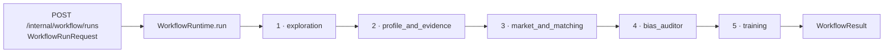
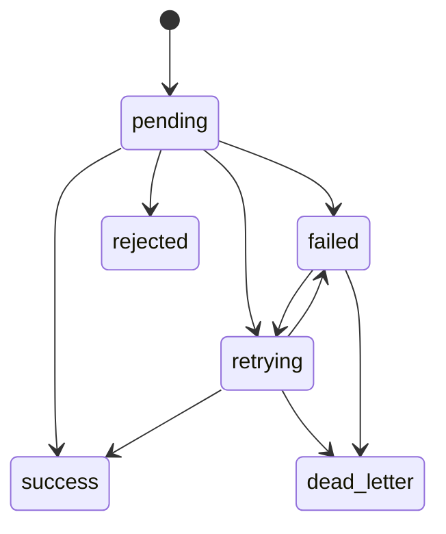
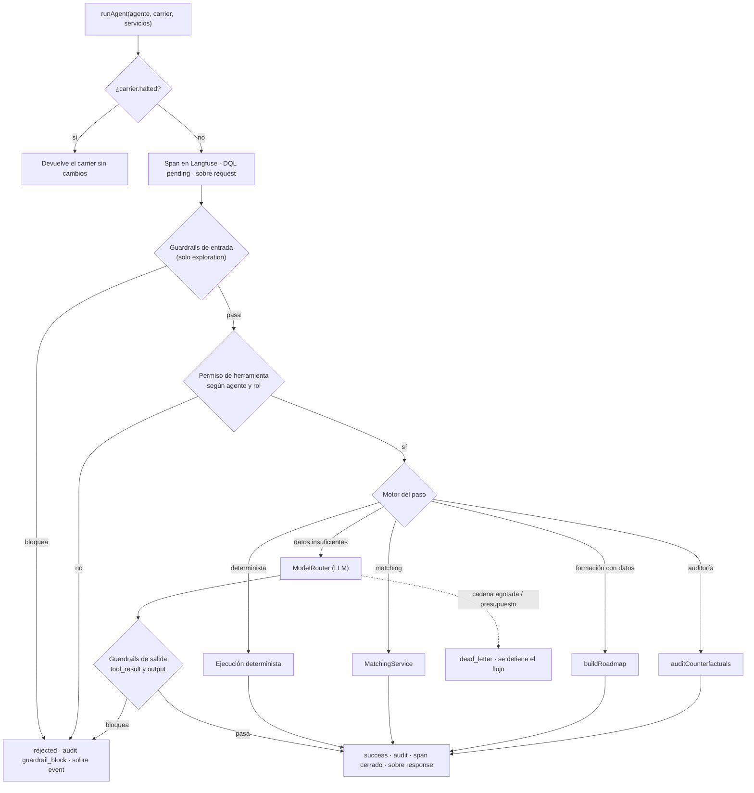
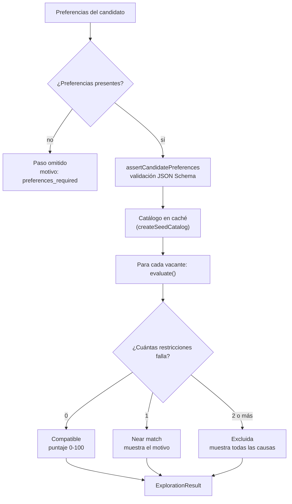
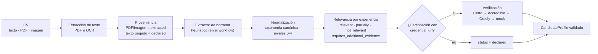
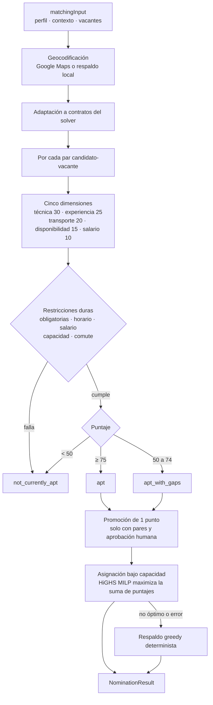
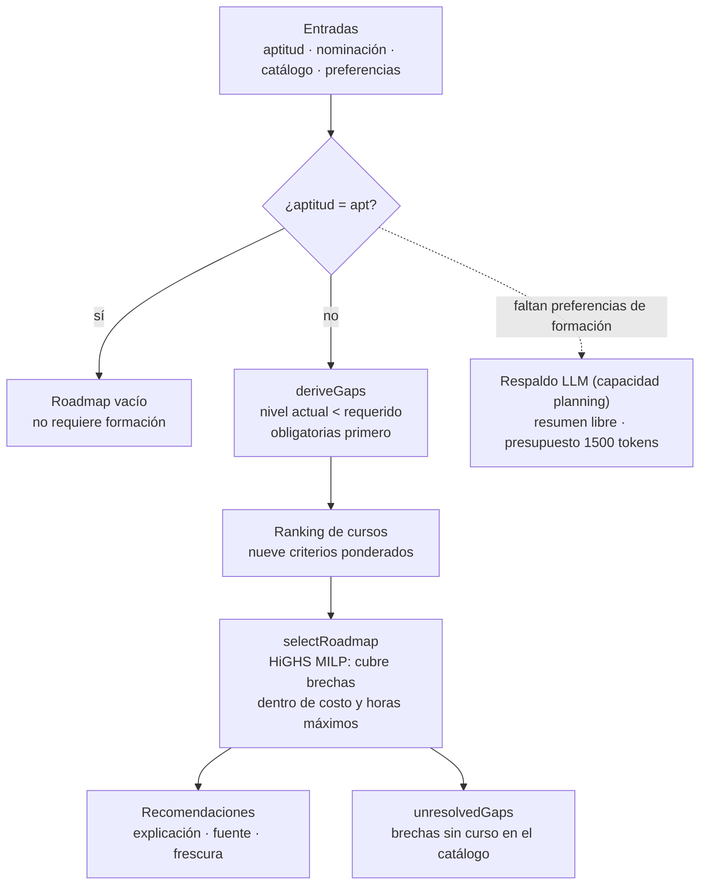
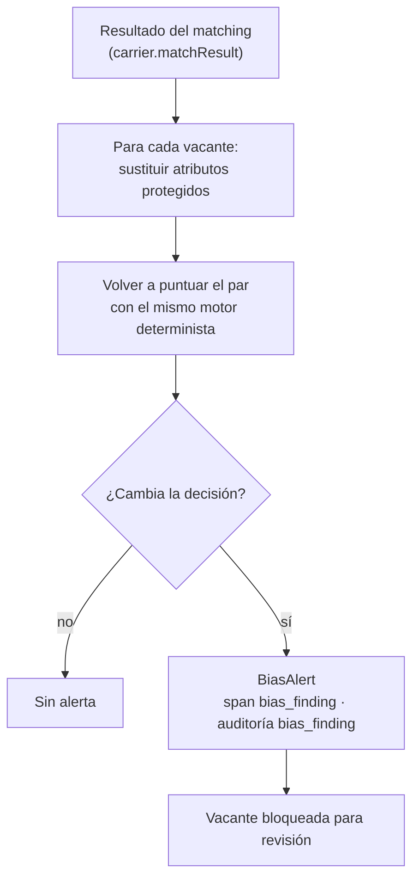

# Funcionamiento del workflow de agentes de WorkBridge

Guía didáctica del workflow de agentes de WorkBridge: qué hace cada agente, qué tipo de componente es, con qué datos trabaja y cómo se encadenan. Cada agente tiene su diagrama.

> Los ejemplos con nombres de casos, cursos y cifras son **ilustrativos**, para entender la mecánica. No son datos del catálogo ni resultados de pruebas.

Fuentes principales (rutas relativas a `Agent-Hackathon/`):

- `apps/agent-runtime/src/workflow/graph.ts`: registro de pasos, orden y `WorkflowRuntime`.
- `apps/agent-runtime/src/workflow/agents.ts`: `runAgent` y la ruta de cada agente.
- `apps/agent-runtime/src/workflow/carrier.ts`: tipo `Carrier`, el objeto que viaja entre pasos.
- `apps/agent-runtime/src/workflow/guardrails.ts`: reglas de seguridad.
- `apps/agent-runtime/src/workflow/models.ts`: cadenas de modelos por capacidad.
- `apps/agent-runtime/src/workflow/observability.ts`: auditoría, registro DQL y trazas.
- `packages/domain/src/types.ts`: tipos compartidos (`AgentId`, `ActorRole`, `WorkflowRunRequest`, `AgentEnvelope`).

---

## 1. Visión general

El workflow es una **cadena lineal de pasos**. Un mismo objeto, el *carrier*, pasa de paso en paso acumulando resultados. Mastra ejecuta la cadena (`createWorkflow(...).then(...).commit()`), y cada paso llama a `runAgent`.

El diagrama oficial de arquitectura (`docs/reference/agents/architecture.md`) muestra solo cuatro agentes. El cuarto, el auditor de sesgo, sí está en el código y se ejecuta. Se explica al final, en la sección 8.

### Idea central

> Ningún agente es un modelo de lenguaje en la ruta normal. Son componentes **deterministas** (reglas, puntajes ponderados, optimización MILP con HiGHS). Un LLM interviene solo como extractor opcional en la ingesta del CV y como respaldo del paso de formación cuando faltan datos.

---

## 2. Tipos y contratos

### 2.1 Identificadores de agente (`AgentId`)

| Valor | Paso | Capacidad de modelo | Herramienta por defecto |
|---|---|---|---|
| `exploration` | 1 | `planning` | `read_goals` |
| `profile_and_evidence` | 2 | `extraction` | `read_cv` |
| `market_and_matching` | 3 | `matching` | `read_vacancy` |
| `bias_auditor` | 4 | `matching` | `audit_counterfactual` |
| `training` | 5 | `planning` | `suggest_course` |

### 2.2 Roles de actor (`ActorRole`)

`candidate`, `counselor`, `employer`, `system`. El rol restringe las herramientas que puede pedir (por ejemplo, un `employer` no puede invocar ciertas herramientas).

### 2.3 Solicitud de entrada (`WorkflowRunRequest`)

| Campo | Tipo | Significado |
|---|---|---|
| `trace_id` | string | Identificador de la traza completa. |
| `idempotency_key` | string | Si se repite, se devuelve el resultado cacheado. |
| `candidateText` | string | Texto del CV (la ingesta ya convirtió PDF/imagen a texto). |
| `vacancyText` | string | Texto de la vacante. |
| `declaredCredentials` | `{id, name}[]` | Credenciales que el candidato declara. |
| `actor` | `{id, role}` | Quién solicita el flujo. |
| `requestedTools` | string[] | Herramientas que se piden; se filtran por guardrails. |
| `preferences?` | `CandidatePreferences` | Preferencias explícitas (modalidad, ubicación, salario, etc.). |
| `matchingInput?` | objeto | Entrada validada para matching: perfil, contexto y vacantes. |

### 2.4 El carrier (`Carrier`)

Es el objeto que viaja entre pasos. Cada agente recibe el carrier y devuelve una copia con sus resultados añadidos.

| Grupo | Campos | Quién lo llena |
|---|---|---|
| Entrada | `traceId`, `idempotencyKey`, `candidateText`, `vacancyText`, `declaredCredentials`, `actorId`, `actorRole`, `requestedTools`, `preferences`, `matchingInput` | Se crea al inicio |
| Matching | `matchResult` | Paso 3 |
| Sesgo | `biasAlerts`, `auditedVacancies` | Paso 4 |
| Formación | `roadmapResult` | Paso 5 |
| Control | `halted`, `status`, `findings`, `summaries`, `modelFallbacks` | Todos |

`status` puede ser `running`, `success`, `rejected` o `dead_letter`. Cuando `halted` es `true`, los pasos siguientes devuelven el carrier sin cambios.

### 2.5 Sobre de mensaje (`AgentEnvelope`)

Cada paso publica sobres de tipo `request` (al empezar), `response` (al terminar con éxito) o `event` (rechazo o fallo). Todos llevan `trace_id`, `idempotency_key`, `agent` y `payload`. Sirven para auditar y reproducir cualquier paso sin ejecutarlo dos veces.

### 2.6 Estados del registro DQL

El registro DQL (*dead letter queue*) lleva el estado de cada paso. Las transiciones permitidas son:

| Estado | Significado |
|---|---|
| `pending` | El paso empezó. |
| `success` | El paso terminó bien. |
| `rejected` | Un guardrail bloqueó el paso. |
| `failed` / `retrying` | Falló un modelo o una llamada; se reintenta con otro. |
| `dead_letter` | Se agotaron los intentos; el flujo se detiene. |

### 2.7 Tipos de guardrail

- **Etapas** (`GuardrailStage`): `input`, `permission`, `tool_result`, `output`, `schema`.
- **Códigos** (`GuardrailCode`): `ok`, `prompt_injection`, `pii_leak`, `invalid_schema`, `invented_credential`, `unauthorized_tool`, `preferences_required`.

### 2.8 Capacidades de modelo (`ModelCapability`)

`extraction`, `matching`, `planning`. Cada una tiene una cadena de modelos de OpenRouter con presupuesto de 1500 tokens:

| Capacidad | Cadena (en orden) |
|---|---|
| `extraction` | `google/gemma-2-9b-it:free` → `meta-llama/llama-3.2-3b-instruct:free` |
| `matching` | `google/gemma-2-9b-it:free` → `mistralai/mistral-7b-instruct:free` |
| `planning` | `google/gemma-2-9b-it:free` → `qwen/qwen-2.5-7b-instruct:free` |

Si un modelo falla, el router pasa al siguiente y registra un `model_fallback`. Si se agota la cadena, el paso queda en `dead_letter`.

---

## 3. El ciclo común de cada paso (`runAgent`)

Todos los agentes pasan por la misma envoltura. Lo que cambia es el "motor" que se usa en el paso 5.

### Pasos de cada ejecución

1. **Antes de empezar**: se abre un span de Langfuse (`traceId:agente`), se registra el estado `pending` en DQL y se publica un sobre `request` con la herramienta y la capacidad.
2. **Guardrails de entrada** (solo `exploration`): se revisan las herramientas pedidas, y se detectan inyecciones de prompt y PII en los textos del candidato y de la vacante.
3. **Permiso**: se verifica que la herramienta esté en la lista del agente y que el rol pueda usarla. `submit_application`, `progress_interview` y `send_message` están prohibidas para todos los agentes.
4. **Motor**: se ejecuta la lógica del agente (ver secciones 4 a 8).
5. **Guardrails de salida** (solo en la ruta del LLM): se revisa el resultado de la herramienta y el texto generado, por ejemplo para detectar credenciales inventadas o datos personales.
6. **Cierre**: estado `success`, auditoría, span cerrado, sobre `response`, y el resumen se añade al carrier.

### Errores

| Situación | Resultado |
|---|---|
| Guardrail bloquea | `rejected`, con auditoría `guardrail_block`. |
| Error de matching | `dead_letter`, con auditoría `matching_dead_letter`. |
| Cadena de modelos agotada o presupuesto excedido | `dead_letter`, con auditoría `model_dead_letter`. |
| Otro error inesperado | Se relanza y falla el workflow completo. |

### Idempotencia

`WorkflowRuntime.run` guarda el resultado por `idempotency_key`. Si llega la misma clave, devuelve el resultado anterior con `idempotentReplay: true` y no vuelve a ejecutar nada.

---

## 4. Agente 1: Exploration

### Descripción

Busca vacantes del catálogo que encajan con las **preferencias explícitas** del candidato. No infiere nada: las preferencias se toman tal cual las declaró.

### Tipo de componente

**Filtro determinista** con validación de contrato (JSON Schema 2020-12 + Ajv). No usa LLM.

### Entradas y salidas

- **Entrada**: `carrier.preferences` (modalidad, ubicación máxima, tipos de contrato, disponibilidad, salario mínimo, roles objetivo).
- **Salida**: `ExplorationResult` con `matches` (compatibles), `nearMatches` (fallan una restricción) y `excluded` (fallan dos o más), más `noMatchCause` cuando no hay resultados.
- **Herramienta**: `read_goals`.

### Cómo funciona

### Ejemplo

Un candidato busca trabajo presencial en Panamá Oeste con salario mínimo de 500 USD.

- Vacante A: presencial, misma provincia, salario 700. **Compatible.**
- Vacante B: presencial, otra provincia, salario 700. **Near match** (solo falla la ubicación).
- Vacante C: remota, otra provincia, salario 300. **Excluida** (falla modalidad, ubicación y salario).

La diferencia entre *near match* y *excluida* está en el número de fallos, no en el puntaje. Así el candidato ve qué le falta a una vacante casi compatible.

Si no hay preferencias, el paso se marca como `skipped` y el flujo sigue, pero sin resultado de exploración.

---

## 5. Agente 2: Profile and Evidence

### Descripción

Convierte el CV en un **perfil estructurado y validado**: habilidades con nivel de 0 a 4, experiencias clasificadas por relevancia, certificaciones con estado de verificación y una marca de revisión humana si hace falta.

### Tipo de componente

**Pipeline de ingesta y normalización**. El extractor de borradores puede ser heurístico o un LLM, pero las reglas que deciden niveles, proveniencia y relevancia son siempre deterministas. El modelo propone; la regla decide.

### Entradas y salidas

- **Entrada**: `candidateText` (texto del CV).
- **Salida**: `CandidateProfile` (habilidades, experiencias, certificaciones, advertencias) más `extraction.needs_review`.
- **Herramientas**: `read_cv`, `list_declared_credentials`.

### Cómo funciona

### Reglas clave

- **Proveniencia**: un dato sacado de un PDF o imagen se marca como `extracted`; el texto que el candidato escribe se marca como `declared`. Las habilidades solo declaradas quedan en nivel 1 como máximo.
- **Relevancia de una experiencia**: se calcula con cobertura de habilidades de los roles objetivo (60 %) y profundidad (40 %), con umbrales fijos. Una descripción demasiado corta devuelve `requires_additional_evidence`.
- **Verificación**: solo las certificaciones con URL se verifican. La cadena de proveedores es Certo, luego Accredible, luego Credly y, si todo falla, un mock.

### Ejemplo

El candidato escribe: "Atendí clientes en un negocio familiar y manejé inventario en Excel". El extractor encuentra `atención al cliente` y `Excel`. Como el texto lo escribió el candidato, esas habilidades quedan como `declared`. La experiencia obtiene `partially_relevant` para un rol de comercio y `requires_additional_evidence` para un rol técnico si la descripción es muy corta.

### Matiz sobre el LLM

Dentro del workflow, el agente se crea sin extractor LLM, así que usa el heurístico. El LLM con respaldo heurístico y un modelo de visión para OCR solo se usan en el flujo de ingesta de `apps/agent-runtime/src/index.ts`, cuando hay `OPENROUTER_API_KEY`.

---

## 6. Agente 3: Market and Matching

### Descripción

Para un candidato y un conjunto de vacantes, calcula **qué tan apto** es en cada una y **asigna** candidatos a vacantes sin superar la capacidad de cada una.

### Tipo de componente

**Puntaje ponderado + restricciones duras + optimización MILP (HiGHS)**. No usa LLM. Es el componente más determinista del sistema.

### Entradas y salidas

- **Entrada**: `carrier.matchingInput` (perfil validado, contexto del candidato y vacantes con horario, salario y capacidad).
- **Salida**: `NominationResult` con `decisions` (una por par candidato-vacante), `assignments` (la asignación final), geocodificación y advertencias. Se guarda en `carrier.matchResult`.
- **Herramientas**: `read_vacancy`, `match_skills`.

### Cómo funciona

### Las cinco dimensiones

| Dimensión | Peso | Qué mide |
|---|---|---|
| Técnica | 30 % | Nivel demostrado frente al requerido. Las obligatorias pesan completo; las deseables, la mitad. |
| Experiencia | 25 % | Nivel general (70 %) y cantidad de evidencias relevantes, saturada en 6 (30 %). |
| Transporte | 20 % | Tiempo de traslado estimado frente al máximo tolerado. |
| Disponibilidad | 15 % | Cobertura de la ventana semanal de la vacante. |
| Salario | 10 % | Relación entre la expectativa salarial y el rango de la vacante. |

### Restricciones duras

Habilidades obligatorias, requisitos mapeados, horario, salario, capacidad, comute geográfico y accesibilidad. Si **una sola falla**, el resultado es `not_currently_apt`, sin importar el puntaje.

### Ejemplo numérico

Un candidato tiene técnica 80, experiencia 60, transporte 70, disponibilidad 90 y salario 50.

Puntaje = 0,30·80 + 0,25·60 + 0,20·70 + 0,15·90 + 0,10·50 = 24 + 15 + 14 + 13,5 + 5 = **71,5 → 72**.

Como 72 está entre 50 y 74, el resultado es `apt_with_gaps`. Si la promoción de un punto se aprobara (con pares elegibles y aprobación humana), subiría a `apt`.

### Asignación

Si varios candidatos compiten por la misma vacante con capacidad limitada, el MILP de HiGHS elige la combinación que maximiza la suma de puntajes sin exceder la capacidad. Si el solver no responde con una solución óptima, se usa un algoritmo greedy determinista. Las soluciones óptimas se canonicalizan para que el mismo input siempre dé el mismo resultado.

### Fallo

Una vacante con más de 72 horas de antigüedad se rechaza. Un error de matching deja el flujo en `dead_letter` y el resto de pasos no se ejecuta.

---

## 7. Agente 5: Training

> Se numera 5 porque en el workflow el auditor de sesgo es el paso 4. En el diagrama de arquitectura oficial aparece como el tercer agente de la lista.

### Descripción

Si el candidato no es `apt`, identifica las **brechas** entre sus habilidades y los requisitos de la vacante objetivo, y propone un **conjunto de cursos** del catálogo que las cubre, respetando costo, horas y preferencias.

### Tipo de componente

**Análisis de brechas + ranking ponderado + optimización MILP (HiGHS)**. El LLM solo se usa como respaldo cuando faltan datos.

### Entradas y salidas

- **Entrada**: la aptitud resultante del matching (la peor de las decisiones), la nominación del paso 3, el catálogo de formación y las preferencias de formación.
- **Salida**: `Roadmap` con recomendaciones (puntaje, brechas que cubre, fuente, frescura, explicación en español), `unresolvedGaps` y totales de costo y horas. Se guarda en `carrier.roadmapResult`.
- **Herramienta**: `suggest_course`.

### Cómo funciona

### Brechas

Una brecha existe cuando el nivel actual de una habilidad es menor que el requerido. Si una habilidad aparece como obligatoria y como deseable, gana la obligatoria. Las brechas se ordenan por id para que el resultado sea reproducible.

### Criterios de ranking

| Criterio | Peso |
|---|---|
| Cobertura de brecha | 30 % |
| Especialización | 15 % |
| Costo | 12 % |
| Duración | 8 % |
| Modalidad | 8 % |
| Geografía | 7 % |
| Horario | 8 % |
| Disponibilidad | 5 % |
| Relevancia de credencial | 7 % |

### Ejemplo

El candidato necesita Excel nivel 3 y tiene nivel 1; la vacante también pide inglés nivel 2 y el candidato no lo tiene.

- Brechas: `Excel` (1 → 3, obligatoria) e `inglés` (0 → 2, deseable).
- El ranking puntúa cursos: un curso de Excel intermedio cubre la primera brecha, un curso de inglés básico cubre la segunda.
- El MILP elige el conjunto que cubre más brechas sin pasar del presupuesto ni de las horas.
- Si no existe ningún curso de inglés en el catálogo, esa brecha queda en `unresolvedGaps` con la nota de que el catálogo debe crecer.

---

## 8. Auditor de sesgo (paso 4)

### Descripción

Revisa si la decisión de matching cambia **solo por atributos protegidos** del candidato (por ejemplo, nombre o marcador de género). Si así ocurre, genera una alerta para revisión humana.

### Tipo de componente

**Auditoría contrafactual determinista**. Vuelve a ejecutar el matching con los atributos protegidos sustituidos y compara resultados. No usa LLM.

### Entradas y salidas

- **Entrada**: `matchingInput`, `matchResult` del paso 3 y el sujeto de sesgo (`biasSubject`).
- **Salida**: `biasAlerts` (vacantes donde la decisión cambió) y `auditedVacancies`. Las vacantes con alerta pueden bloquearse.
- **Herramienta**: `audit_counterfactual`.

### Cómo funciona

### Ejemplo

Un candidato recibe `apt_with_gaps` en la vacante X. Al cambiar un atributo protegido en la simulación, la misma vacante pasa a `not_currently_apt`, sin que cambien habilidades ni horario. Se genera una alerta y el consejero debe revisarla antes de avanzar.

---

## 9. Salida final: `WorkflowResult`

Al terminar, `WorkflowRuntime.run` devuelve:

| Campo | Contenido |
|---|---|
| `status` | `success`, `rejected` o `dead_letter`. |
| `findings` | Bloqueos de guardrails acumulados. |
| `agents` | Resumen de cada paso ejecutado. |
| `modelFallbacks` | Cambios de modelo ocurridos. |
| `envelopes` | Todos los sobres publicados. |
| `mastraSteps` | Pasos que realmente se ejecutaron. |
| `match?` | Resultado de matching. |
| `biasAlerts` | Alertas del auditor. |
| `auditedVacancies` | Vacantes tras la auditoría. |
| `roadmap?` | Ruta de formación. |

### Transporte HTTP

`POST /internal/workflow/runs` recibe un `WorkflowRunRequest`. Si el cliente pide `Accept: text/event-stream`, recibe un flujo SSE con eventos `envelope`, `lifecycle` y `trace`, y al final un evento `result`. Si no, recibe el JSON final.

---

## 10. Reglas de seguridad transversales

- **Herramientas prohibidas para agentes**: `submit_application`, `progress_interview`, `send_message`.
- **Aprobación humana obligatoria**:
  1. El candidato debe aprobar el borrador de solicitud antes de enviarla.
  2. Un consejero resuelve brechas críticas, credenciales sin verificar, alertas de sesgo o restricciones de transporte.
  3. Un empleador aprueba el avance a entrevista.
- **PII**: los textos que van a un modelo se redactan antes de enviarse (`redactPii`), y se detectan inyecciones de prompt en la entrada.
- **Sin invención**: el resultado de un modelo no puede afirmar credenciales que el candidato no declaró (`invented_credential`).

---

## 11. Glosario

| Término | Definición |
|---|---|
| Carrier | Objeto que viaja entre pasos y acumula resultados. |
| Sobre (envelope) | Mensaje auditable entre pasos, con `trace_id` e `idempotency_key`. |
| DQL | Registro de estados de cada paso, con `dead_letter` como estado terminal de fallo. |
| Guardrail | Regla que bloquea una entrada, herramienta, resultado o salida no permitidos. |
| Aptitud | Clasificación del candidato para una vacante: `apt`, `apt_with_gaps` o `not_currently_apt`. |
| Brecha | Diferencia entre el nivel actual de una habilidad y el requerido. |
| Near match | Vacante que falla exactamente una restricción de exploración. |
| MILP | Programación lineal entera mixta: problema de optimización resuelto con HiGHS. |
| Contrafactual | Simulación con un atributo cambiado para medir si la decisión depende de él. |

---

## 12. Discrepancias detectadas

- **Cuatro frente a cinco pasos**: el diagrama de arquitectura y el README hablan de cuatro agentes y dicen que el auditor de sesgo no está implementado. En el código, `graph.ts` lo registra como paso 4 y `agents.ts` lo ejecuta.
- **LLM en el paso de perfil**: el diagrama sugiere un LLM en Profile. En el workflow se usa el extractor heurístico; el LLM solo está en la ingesta.
- **Numeración**: en este documento Training es el paso 5 y aparece después del auditor, aunque en el diagrama oficial aparece como cuarto agente.
