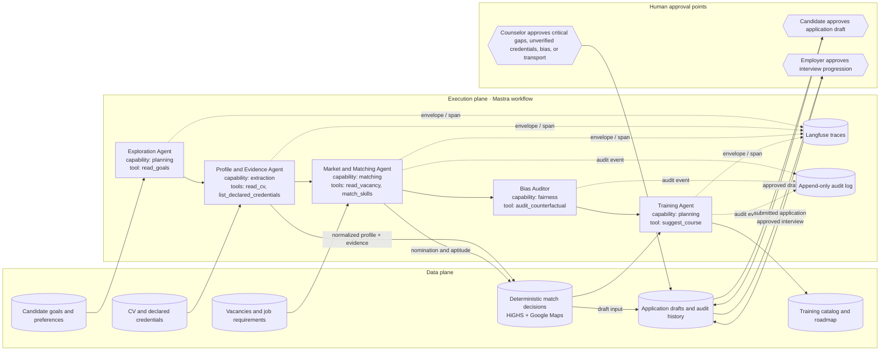

# WorkBridge agent architecture

This diagram is the source of truth for the shipped agent workflow. It shows
the five agents registered in `apps/agent-runtime/src/workflow/graph.ts`, their
runtime tools, the data and execution planes, and every human approval boundary.
Application submission is deliberately outside the agent workflow.

## Runtime contract

The execution plane runs in this order: `exploration` →
`profile_and_evidence` → `market_and_matching` → `bias_auditor` → `training`. Every step emits
an agent envelope, lifecycle record, and trace span. Audit events are emitted
for the matching, bias-audit, and training paths shown above, and for model-completion and
guardrail outcomes where applicable; the deterministic Exploration and Profile
paths publish their result without an audit event. Guardrails screen requested
tools, permissions, inputs, model output, and tool results;
`submit_application`, `progress_interview`, and `send_message` remain denied to
agents.

The data plane is separate from execution: profiles and vacancy documents enter
as validated contracts, matching is deterministic, and training consumes the
resulting gaps to build a roadmap. Certo credential verification and its
Accredible/Credly/mock fallbacks are part of the Profile and Evidence data path,
not additional workflow agents.

## Approval boundaries

1. A candidate must approve an application draft before submission.
2. A counselor must resolve critical gaps, unverified credentials, bias alerts,
   or transport constraints when those findings require review.
3. An employer must approve interview progression after an application is
   submitted.

No agent can bypass these boundaries. The bias auditor is shipped in the workflow;
the simulated interview module is not part of the primary workflow demo unless its
end-to-end evidence is included in the final delivery.
