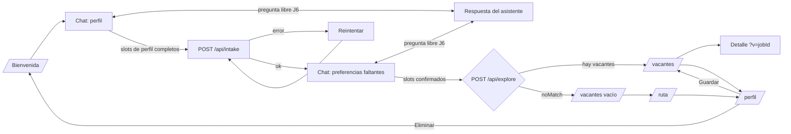
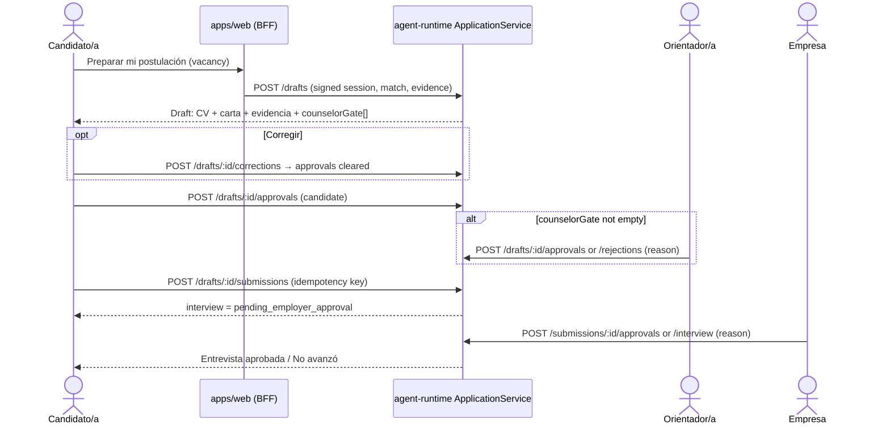

# UX Flows and Interaction Design

Produced with the `interaction-design` skill. Covers the happy path, branches, feedback, and
recovery for every journey in [spec.md](spec.md). Copy is the Spanish text users see.

## Journeys

| ID | Journey | Entry | Exit |
|---|---|---|---|
| J1 | First visit: profile → preferences → results | `/` | `/vacantes` or `/ruta` |
| J2 | Explore a vacancy | `/vacantes` | detail sheet/panel, original posting |
| J3 | No viable vacancy → training route | `/vacantes` empty state | `/ruta` |
| J4 | Returning visit: review and edit profile | any route with nav | `/perfil` → updated `/vacantes` |
| J5 | Delete my data | `/perfil` | `/` |
| J6 | Ask the assistant something (free conversation) | `/chat`, any step | back to the pending slot |
| J7 | Prepare, approve, and send an application (candidate) | vacancy detail | `/postulaciones/<id>` status "Enviada" |
| J8 | Review a gated application (counselor) | `/orientador` | approved or rejected draft |
| J9 | Decide interview progression (employer) | `/empresa` | "Entrevista aprobada" / "No avanzó" |
| J10 | Sign up / sign in / upgrade an anonymous session | `/ingresar`, or "Preparar mi postulación" | role home |



## Chat model

The chat is an **LLM-guided conversation over a deterministic slot agenda** (ADR-0006).

```
            ┌──────────── user message (text / chip / voice / file) ───────────┐
            ▼                                                                  │
   ┌──────────────────┐   transcript + slot state   ┌──────────────────────┐  │
   │ Client: useChat  │ ─────────────────────────▶  │ POST /api/chat       │  │
   │ (slot state,     │                              │ handleChatTurn       │  │
   │  transcript)     │ ◀─────────────────────────   │  ├ SlotTracker (det.)│  │
   └──────────────────┘   ChatTurn {reply,           │  ├ ChatFn (LLM, JSON)│  │
            │              slotUpdates, chips,       │  └ fallback (det.)   │  │
            │              intent}                   └──────────────────────┘  │
            ▼                                                                  │
     render bot bubble + chips ────────────────────────────────────────────────┘
```

- **SlotTracker (deterministic, server).** Owns the agenda: which slots exist, their priority,
  and their state — `missing`, `incomplete`, `proposed`, `filled`. It picks the **pending slot**
  for each turn. The LLM never decides completeness.
- **LLM (`ChatFn`, JSON-schema output).** Receives the transcript window, the pending slot, and the
  slot states. It (a) writes a warm reply that asks for the pending slot, (b) proposes values for
  any slot it can read from the user's free text (`slotUpdates`, state `proposed`), (c) when the
  user asks something, answers first (`intent: "answer"`) and then re-asks the pending slot.
- **Confirmation rule (AC-47).** A `proposed` value becomes `filled` only when the user taps a
  chip or answers "Sí" to the confirmation chip the client renders, e.g. "¿Entonces trabajaste
  más de un año en la tienda de tu tía? **Sí** · **Cambiar**". This keeps preferences
  `candidate_explicit`.
- **Fallback (AC-48, AC-49).** No API key, model error, invalid JSON after one retry, or 20 s
  timeout → the server returns the slot's deterministic fallback question and chips (tables below).
  The conversation never dead-ends.

### `ChatTurn` contract (response of `POST /api/chat`)

```ts
interface ChatTurn {
  intent: 'ask_slot' | 'answer' | 'confirm' | 'complete_phase';
  reply: string;                      // es-PA, ≤ 600 chars, no markdown links
  pendingSlot: SlotId | null;
  slotUpdates: Array<{ slot: SlotId; value: unknown; state: 'proposed' | 'incomplete' }>;
  chips: Array<{ label: string; value?: unknown; kind: 'answer' | 'confirm' | 'change' | 'retry' }>;
  phase: 'profile' | 'preferences' | 'done';
  source: 'llm' | 'fallback';         // for logs only, never rendered (NG4)
}
```

## Slot agenda

Priority is top-to-bottom within each phase. "Incomplete" defines when the tracker asks again.
Fallback question = what the deterministic path asks, and the tone reference for the LLM prompt.
`{name}` is client-only and never sent to the API (spec R6).

### Profile phase

| # | Slot | Incomplete when | Fallback question | Fallback chips |
|---|---|---|---|---|
| 0 | `greeting` (name, optional) | — (skippable) | "¡Hola! Soy WorkBridge 👋 Te voy a hacer unas preguntas para conocer lo que sabes hacer. También puedes preguntarme lo que quieras. ¿Cómo te llamo?" | "Prefiero no decirlo" |
| 1 | `cv_source` | — | "¿Tienes un CV o una hoja de vida?" | "Sí, lo subo 📎", "No tengo / prefiero contarte" |
| 2 | `experiences[]` | 0 entries and the user has not said "Todavía no" | "¿Has trabajado o ayudado en algún lugar? Vale todo: negocio familiar, voluntariado, trabajos por tu cuenta, proyectos del colegio…" | "Todavía no" |
| 3 | `experiences[i].tasks` | entry has no task | "¿Qué hacías ahí?" | "Atender clientes", "Caja / cobrar", "Inventario", "Redes sociales", "Reparar computadoras o celulares", "Organizar documentos" |
| 4 | `experiences[i].duration` | entry has no duration | "¿Por cuánto tiempo lo hiciste?" | "Menos de 3 meses", "3 a 12 meses", "Más de un año", "Todavía lo hago" |
| 5 | `experiences_more` | asked < 1 time and entries < 3 | "¿Tienes otra experiencia que quieras contarme?" | "Sí, otra", "No, sigamos" |
| 6 | `education` | empty | "¿Qué has estudiado o estás estudiando?" | "Secundaria / bachiller", "Técnico", "Universidad", "Cursos en línea" |
| 7 | `target_roles` | empty and not readable from the CV | "¿En qué te gustaría trabajar?" | "Atención al cliente", "Soporte técnico", "Administrativo", "Ventas", "Otro" |

When a CV is attached (slot 1), it is sent to `/api/intake` right away; slots 2–7 are
pre-evaluated against the resulting profile and only the gaps are asked. The chat transcript is
later merged into the same profile on the server (OQ-2).

**Phase completion.** All non-optional slots `filled` (or explicitly skipped) → `intent:
"complete_phase"` → reply "¡Gracias! Estoy leyendo lo que me contaste…" → client sends the
transcript to `/api/intake` (`kind: "text"`, or `"audio_transcript"` when every answer came from
voice).

**Result message.** "Listo, {name}. Encontré **N habilidades** y **M experiencias**, ¡incluida tu
experiencia informal! 💪" plus up to 4 read-only skill chips. When `needs_review`: append
"Algunos datos los vamos a confirmar contigo en Mi perfil."

### Preference phase

Opens with "Ya sé bastante de ti. Solo me faltan unas cosas para buscarte vacantes." Slots already
known from the profile (today only `target_roles`) start as `filled`.

| # | Slot → field(s) | Fallback question | Fallback chips → value | Default if skipped |
|---|---|---|---|---|
| Q1 | `target_roles` | (only if still empty) as slot 7 | — | required |
| Q2 | `zone` → `max_location.province`, `.district` | "¿En qué zona te queda bien trabajar?" | "Panamá (ciudad)", "San Miguelito", "Panamá Oeste", "Otra" → free text | required |
| Q3 | `modality` | "¿Cómo prefieres trabajar?" | "Presencial" `onsite`, "Híbrido" `hybrid`, "Desde casa" `remote` | `onsite` |
| Q4 | `schedule` → `availability`, `contract_types` | "¿Qué horario te funciona?" | "Lunes a viernes, de día" → days 1–5, 08:00–17:00, 40 h, `full_time`; "Medio tiempo" → days 1–5, 08:00–13:00, 25 h, `part_time`; "Fines de semana" → days 6,0, 08:00–17:00, 16 h, `part_time` | first preset |
| Q5 | `minimum_salary_usd` | "¿Cuál es el salario mínimo mensual que aceptarías?" | "USD 400", "USD 600", "USD 800", "Otro" → number | 600 |
| Q6 | `willing_to_train` | "Si te falta algo, ¿te animarías a tomar cursos cortos?" | "¡Sí!" `true`, "Por ahora no" `false` | `true` |

Non-essential defaults (editable in Mi perfil → Más opciones): `transport_modes: ["transit"]`,
`max_travel_minutes: 60`, `monthly_transport_budget_usd: 40`, `willing_to_intern: false`,
`locale: "es-PA"`, `max_location.country: "PA"`.

Closing: "¡Listo! Buscando vacantes para ti…" → `POST /api/explore` → `/vacantes` (or its empty
state when `noMatch`).

## Free conversation (J6)

Examples of what the user may ask, and the expected behavior:

| User writes | Assistant does | Slot effect |
|---|---|---|
| "¿Qué hace alguien de soporte técnico?" | Explains in 2–3 sentences, then re-asks the pending slot | none |
| "¿Para qué quieres saber mi salario?" | Explains it filters vacancies below that amount and is never shared, then re-asks | none |
| "Trabajé 2 años en un call center" (while asked about education) | Thanks, proposes `experiences[+]` with duration "Más de un año" + confirmation chip, then returns to education | `proposed` |
| "¿Me van a contratar?" | States it cannot promise a job; it helps find vacancies and courses | none |
| "Postúlame a esa" | States it does not send applications; the user decides and applies from the original posting | none |
| Off-topic / abusive | Short, kind redirect to the pending slot | none |

Grounding (AC-50, OQ-7): answers about specific vacancies, salaries, or courses use only the
candidate's own profile, exploration, match decisions, and roadmap; generic career explanations
are allowed and introduced as general ("En general…"). The assistant never invents vacancies,
employers, salaries, or courses, and does not query the catalog before preferences are complete.

## Application lifecycle (J7–J9)

Rules come from ADR-0003 and `ApplicationService`; the UI mirrors them and never decides them.



### Application status

Derived in the UI from `DraftView` and `SubmitView` (first matching row wins):

| Condition | Status label | Candidate's next action |
|---|---|---|
| `draft.status = "rejected"` | Rechazada | none — shows role and reason |
| `submitted`, `interview = "approved"` | Entrevista aprobada | "La empresa te contactará." |
| `submitted`, `interview = "rejected"` | No avanzó | link to `/ruta` |
| `submitted`, `interview = "pending_employer_approval"` | Enviada | none |
| `open`, `candidateApproved = false` | Borrador | "Revisar y aprobar" |
| `open`, approved, `counselorGate` not empty, `counselorApproved = false` | En revisión del orientador | none — shows gate reasons |
| `open`, approved, gate empty or `counselorApproved` | Lista para enviar | "Enviar postulación" |

### Gate reasons in plain Spanish

| `GateReason.code` | Candidate copy | Counselor label |
|---|---|---|
| `critical_gap` | "Te falta un requisito importante para este puesto: {detail}." | Brecha crítica |
| `unverified_credential` | "Una de tus certificaciones todavía no se pudo verificar." | Credencial sin verificar |
| `bias_alert` | "La vacante tiene un requisito que debemos revisar para que sea justo contigo." | Alerta de sesgo |
| `infeasible_transport` | "El traslado a este trabajo parece muy difícil con tus opciones de transporte." | Transporte inviable |

### Authentication (J10)

- Anonymous start: `/`, `/chat`, `/vacantes`, `/ruta` work with a Better Auth anonymous session;
  linking Google or a magic-link email keeps everything under the same candidate (OQ-3).
- Sign-in is required for: saving searches, "Preparar mi postulación", `/postulaciones`,
  `/orientador`, `/empresa`. The interrupted action resumes after sign-in (`?next=`).
- After sign-in, users go to their role home: candidate → `/vacantes` (or `/chat` when the
  profile is empty), counselor → `/orientador`, employer → `/empresa`.

## Interaction patterns

| Pattern | Where | Feedback |
|---|---|---|
| Progressive disclosure | Chat slots; Mi perfil "Más opciones" | One pending slot at a time; collapsed advanced fields |
| Quick replies | Slot questions with closed options | Selected chip becomes the user bubble; chips disappear |
| Confirmation chips | Values the LLM proposed from free text | "Sí" fills the slot; "Cambiar" re-asks it |
| Skeleton screen | `/vacantes`, `/ruta`, `/perfil` loading | Three card skeletons / list skeletons |
| Typing indicator | Chat while waiting for `/api/chat` or `/api/intake` | Animated dots; after 3 s "Estoy pensando…"; live region announces once |
| Inline validation | Mi perfil fields, salary "Otro" | Message under the field on blur |
| Confirmation dialog | "Eliminar mis datos" | Names what is deleted; "Cancelar" is the default focus |
| Toast | Save in Mi perfil, saved search | "Actualizamos tus vacantes", auto-dismiss 5 s, also in a live region |
| Edit last answer | Chat | "Cambiar" on the latest user bubble resets that slot to `missing` |

## State matrix

| View | Loading | Empty | Error | Success |
|---|---|---|---|---|
| Chat | typing indicator, composer disabled | n/a | bot retry message + "Reintentar" chip | next bot message |
| Vacantes | 3 skeleton cards | `noMatch` empty state + "Ver mi ruta" | inline card "No pudimos cargar tus vacantes" + "Reintentar" | card list |
| Detalle | skeleton in sheet | unknown `?v=` → toast "Esa vacante ya no está disponible", param removed | same as empty | full detail |
| Mi ruta | list skeleton | `willing_to_train=false` → explanation + toggle; no recommendations → "Todavía no hay cursos para tus brechas" | inline retry | ordered steps |
| Mi perfil | form skeleton | no session → redirect to `/` | inline retry; field errors from `details[]` mapped to fields | form + toast on save |
| Postulaciones | list skeleton | "Todavía no has preparado ninguna postulación" + link to `/vacantes` | inline retry | status list |
| Postulación | document skeleton | n/a | runtime 422 codes mapped to copy (below) | documents + actions |
| Orientador queue | table/card skeleton | "No hay postulaciones esperando tu revisión 🎉" | inline retry | queue |
| Empresa queue | table/card skeleton | "No hay postulaciones pendientes" | inline retry | queue |

## Errors and recovery

| Failure | Message (es-PA) | Recovery |
|---|---|---|
| Network down | "Parece que no hay conexión. Revisa tu internet y vuelve a intentar." | "Reintentar" resends the same request |
| `/api/chat` model failure | none shown — fallback question is used (`source: "fallback"`) | Transparent to the user |
| Intake 422 | "No pude leer bien tu información. ¿Me la cuentas con otras palabras?" | Experience slots reset to `incomplete`; transcript intact |
| Explore 400 `details[]` | In chat: "Revisemos un dato:" + re-ask that slot; in Mi perfil: message under the field | Re-ask / edit |
| File > 10 MB / wrong type | "Ese archivo pesa más de 10 MB. Prueba con otro." / "Solo puedo leer PDF o fotos." | Stay on `cv_source` |
| Mic permission denied | "No tengo permiso para usar el micrófono. Puedes escribir tu respuesta." | Focus the input |
| Delete fails | "No pudimos eliminar tus datos. Intenta de nuevo." | Dialog stays open |
| `candidate_approval_required` | "Primero aprueba tu postulación." | Focus "Aprobar mi postulación" |
| `counselor_approval_required` | "Tu orientador/a todavía está revisando esta postulación." | Status refresh |
| `already_submitted` (409) | "Esta postulación ya fue enviada." | Show status "Enviada" |
| `draft_rejected` | "Esta postulación fue rechazada y no se puede enviar." | Show reason |
| `unknown_evidence` | "Solo puedes usar experiencias y certificados que ya declaraste." | Revert the correction |
| `invalid_session` / `expired_session` (401) | "Tu sesión terminó. Ingresa de nuevo." | `/ingresar?next=<current>` |
| `forbidden` (403) | "No tienes acceso a esta página." | Redirect to role home |

## Rules applied (from `interaction-design`)

- Every action and async change has visible and announced feedback (live regions, see
  [accessibility.md](accessibility.md)).
- The only destructive action (delete data) is deliberate: destructive variant + confirmation.
- Transitions behave the same with keyboard, pointer, touch, and screen reader.
- The free-conversation branch always returns to the pending slot, so the happy path is never lost.
- After 40 LLM turns the chat continues with fallback questions only (AC-81); the user is told once.
